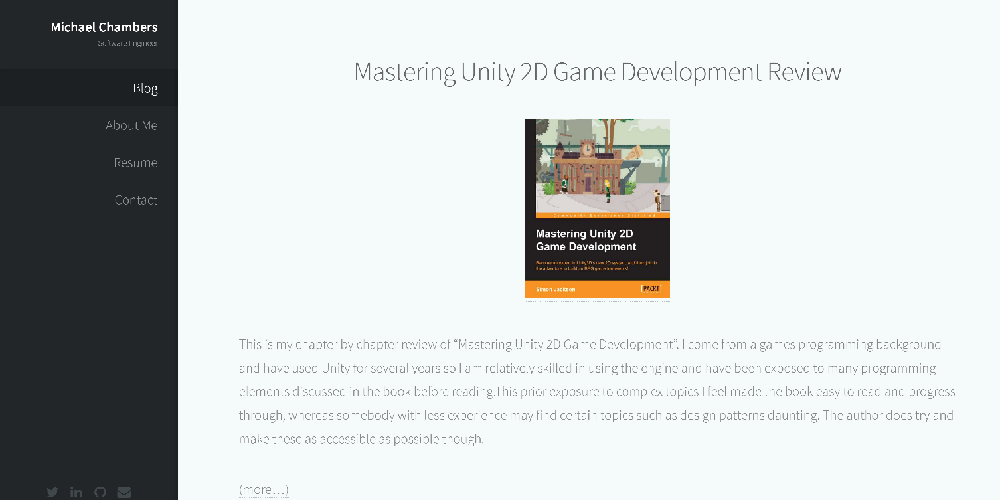

# Prologue WordPress Theme

> **Archived.** This repository is read-only and no longer maintained. The theme was built in January 2017 against **WordPress 4.7** and hasn't been updated or tested on any later version of WordPress or PHP. Use it as a reference, or fork it if you want to bring it up to date.

A WordPress port of the [Prologue](https://html5up.net/prologue) template by [HTML5 UP](https://html5up.net/). It stays as close to the original design as possible, with a few minor changes. You can see the original in the [live demo](https://html5up.net/uploads/demos/prologue/).

## What's included

- A single `index.php` template that lists posts with pagination, featured images and page links
- A `primary` navigation menu, registered as **Navigation**, which shows in the left-hand sidebar
- The original template's CSS, Sass sources, Font Awesome icons and jQuery scripts, under `assets/`
- A `screenshot.png` that shows as the theme's thumbnail on Appearance → Themes

## Known limitations

- **Personal details are hardcoded.** `header.php` contains the author's name, job title, social links and a Google Analytics tracking ID. `footer.php` contains the copyright line. If you reuse the theme, edit or remove them.
- **The Google Analytics snippet no longer works.** It uses Universal Analytics, which Google shut down in 2023.
- **No `wp_head()` or `wp_footer()` hooks.** Plugins that add scripts, styles or the admin bar won't work.
- **No icons in the navigation.** The original template puts Font Awesome icons in its menu, and the port doesn't, because they couldn't be added through the WordPress menu system.
- **The Internet Explorer fallbacks are broken.** The IE 8/9 stylesheets and scripts in `header.php` use relative paths that don't resolve under WordPress.
- **The Blog menu item is matched by title.** On single posts, `functions.php` highlights the menu item only if it's titled exactly `Blog`.

## Installation

1. Download this repository as a ZIP, or clone it into `wp-content/themes/`.
2. In WordPress, go to **Appearance → Themes** and activate **Prologue HTML5 Convert**.
3. Under **Appearance → Menus**, create a menu and assign it to the **Navigation** location.

## Credits

The original design is [Prologue](https://html5up.net/prologue) by [HTML5 UP](https://html5up.net/), released under the [Creative Commons Attribution 3.0 licence](https://html5up.net/license). The WordPress port is by [Michael Chambers](https://github.com/MChambers1992).
